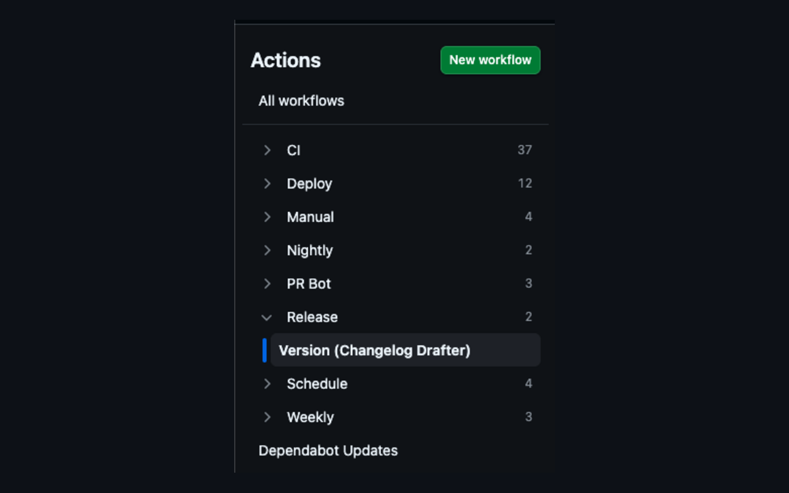
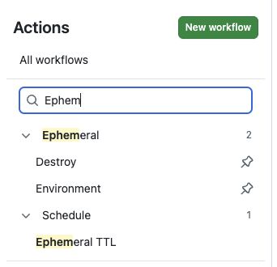

# Actions Sidebar Folders

Chrome extension (Manifest V3) that nests GitHub Actions sidebar workflows by slash-separated `name:` prefixes (up to 3 folder levels), with settings for disabled workflows.

Independently implemented from scratch. Inspired by the general idea of folder-grouping slash-named workflows — not a fork of any existing extension.





## Install (Load unpacked)

1. Clone or download this repository
2. Open `chrome://extensions`
3. Enable **Developer mode**
4. Click **Load unpacked** and select this folder
5. Open a repo’s **Actions** tab on github.com

For a prebuilt package, see [GitHub Releases](https://github.com/razbensimon/actions-sidebar-folders/releases) (zip and CRX from `pnpm package`, which omit the local debug host permission). Consumer Chrome usually blocks CRX sideload — prefer the zip + Load unpacked, or the Web Store.

## Chrome Web Store

Dev (this repo) keeps `http://127.0.0.1:3927/*` so [Debug mode](#development) can reach `pnpm dev:logs`. Store/release packages **strip** that host.

```bash
pnpm release:zip   # test + write dist/actions-sidebar-folders-<version>.{zip,crx}
```

CRX signing key defaults to `~/.config/actions-sidebar-folders/extension.pem` (outside the Load unpacked root — Chrome warns if a `.pem` sits in the extension folder). Override with `ASF_CRX_KEY_PATH`. Back up the PEM — losing it changes the extension ID.

Listing copy, privacy URL, permission justifications, and screenshot checklist: **[STORE.md](./STORE.md)**.  
Privacy policy: **[PRIVACY.md](./PRIVACY.md)**.  
Security reports: **[SECURITY.md](./SECURITY.md)**.

## Settings

Right-click the extension → **Options** (or Details → Extension options):

| Setting | Default |
|---|---|
| Disabled workflows: Hide / Folder / Leave flat | **Hide** |
| Collapse folders by default | **On** (path to the active workflow still expands) |
| Group Dependabot workflows | **On** (managed Dependabot Updates / Dependency Graph under **Dependabot**) |
| Show pinned workflows at the top | **On** (GitHub-pinned workflows are duplicated above the folder tree and still appear in their folders) |
| Debug mode | **Off** |

Max folder depth is fixed at **3**. Extra `/` segments stay on the leaf label (`CI / Lint / JS / Unit / Foo` → folders `CI` → `Lint` → `JS`, leaf `Unit / Foo`).

## How it works

- Works with both Actions sidebars GitHub serves:
  - **React sidebar** (Primer React `NavList`): reads the same-origin `_workflows` JSON GitHub's own "Show more" uses (falls back to `workflows_partial`), hides the native list with CSS, and paints the folder tree beside it. Leaf clicks go through the hidden native link, so navigation stays client-side.
  - **Legacy sidebar**: reads workflow rows from the sidebar and GitHub’s `workflows_partial` HTML, and regroups them in place.
- Uses your session cookies only (**no PAT**)
- Splits names on `/` (whitespace around `/` is fine)
- Optionally groups GitHub’s managed Dependabot Updates and Dependency Graph under a **Dependabot** folder (toggle in Options)
- Duplicates GitHub-pinned workflows at the top of the list (like GitHub’s native sidebar) while leaving them in their folders (toggle in Options)
- Filter box above the tree matches the full name (`unit` finds `CI / Test / Unit`), space-separated terms are AND-ed, matches are highlighted, and folders holding matches expand until the query is cleared
- Re-applies on Turbo / SPA navigations
- If fetch/parse fails, GitHub’s native sidebar is left alone

## Permissions

- `storage` — save options in Chrome sync
- `https://github.com/*` — content script + same-origin workflow list fetch

No analytics. No third-party servers.

## Development

```bash
pnpm test
pnpm dev:logs   # optional: stream [ASF] logs to terminal + .asf-debug.log
pnpm dev:sync   # pull this checkout, then reload open Actions tabs
```

`pnpm dev:sync` is for the clone Chrome has loaded unpacked: it fast-forwards the
checkout, prints what changed, and refreshes any open Actions tabs. Chrome only
re-reads extension files when the extension itself is reloaded, so still click ⟳
(or Options → **Reload extension now**) afterwards.

### Fast local loop

1. Load unpacked from this repo folder (once)
2. Edit code → Options → **Reload extension now** (or ⟳ on `chrome://extensions`) → refresh the Actions tab
3. Enable **Debug mode** in Options
4. (Optional) Run `pnpm dev:logs` so Cursor/agents can watch the same stream

**Where to look**

| What | Where |
|---|---|
| `[ASF]` logs | DevTools on the **GitHub tab** → Console (filter `ASF`) |
| Stream for agents | Terminal running `pnpm dev:logs`, or `.asf-debug.log` |
| Live snapshot | Console context → this extension’s content script → `__ASF_DEBUG__` / `__ASF_DEBUG__.dump()` |
| DOM summary | Elements → `nav[aria-label="Actions Workflows"]` → attribute `data-asf-debug` |
| Force rebuild | In content-script console context: `__ASF_DEBUG__.rebuild()` |

Content scripts run in an isolated world: pick the extension context in the Console context dropdown (not `top`) to read `__ASF_DEBUG__`. Logs still appear in the normal page console.

## License

[Apache License 2.0](./LICENSE)
